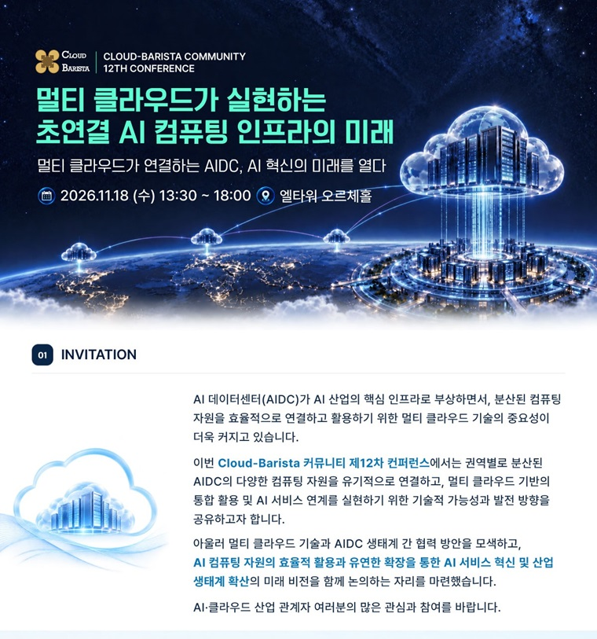
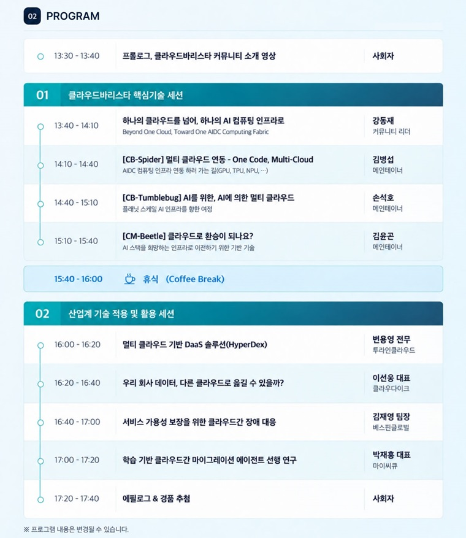
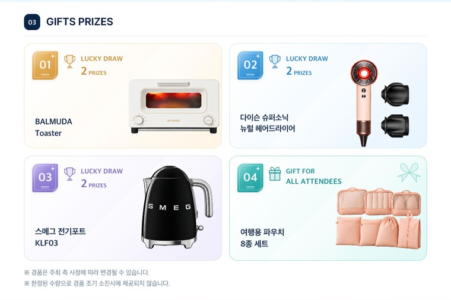

클라우드바리스타(Cloud-Barista) 오픈소스 커뮤니티가 멀티 클라우드 기술을 선도하며, AI 기술 개발환경과 서비스의 혁신적인 활용을 지원하기위한 컴퓨팅 인프라로서 제한없는 클라우드 활용을 지원하는 Cloud-Barista 개발 결과물과 노하우를 공개하고, 멀티 클라우드 기술의 국내 내재화를 추진함으로써 산업계와 함께 차기 클라우드 생태계에 대응하고자 제12차 컨퍼런스를 개최하게 되었습니다.
 

금번 제12차 컨퍼런스에서는 권역별로 분산된 AIDC의 다양한 컴퓨팅 자원을 유기적으로 연결하고, 멀티 클라우드 기반으로 통합 활용 및 AI 서비스 연계를 실현하기 위한 기술적 가능성과 발전 방향을 공유하며, 국내 수요자의 니즈와 해결해야할 이슈 등을 논의합니다.

또한, 금번 행사는 '**멀티 클라우드가 연결하는 AIDC, AI 혁신의 미래를 열다**' 라는 타이틀로 진행될 예정이며, 열네번째 소스코드 버전인 '**쟈스민 (Jasmine)**'과 함께 향후 Cloud-Barista 개발 방향이 소개될 예정입니다.
 
<!--more-->

금번 컨퍼런스는 **현장 중심(Offline Seminar)**으로 진행되며, 이번 열두번째 행사에도 많은 관심과 참여를 부탁드립니다.

  - 행사 사전 등록 페이지 : [https://webinaro.co.kr/Event/397](https://webinaro.co.kr/Event/397 "행사 내용 및 등록 페이지"){:target="_blank"}
  - 사전 등록 후 행사에 참석하신 분들께 기념품을 제공해드릴 예정입니다.

 
감사합니다.
 

<table width="760" id="Table_01" border="0" cellspacing="0" cellpadding="0">
	<tbody>
    <tr>
		<td>
			
        </td>
	</tr>
    <tr>
		<td>
			
        </td>
	</tr>
    <tr>
		<td>
			
        </td>
	</tr>    
    </tbody>
</table>

 ※ 클라우드바리스타(Cloud-Barista)는 커뮤니티/소스코드명/기여자를 지칭하는 공통 용어로 사용됩니다.

 

**행사 문의 연락처**

 
    *	행사 운영사무국 전화 : 02-6354-0427 / E-mail : jaey26@kcloud.or.kr

 

**Cloud-Barsita 기술 및 커뮤니티 Q&A 연락처**

    *	E-mail : contact-to-cloud-barista@googlegroups.com

 

**소스 코드 공개 안내**

   > Cloud-Barista 12차 release 버전(Jasmine) 소스 코드 및 관련 문서는 본 컨퍼런스 개최 후 [본 홈페이지 download page](https://cloud-barista.github.io/download/ "본 홈페이지 download page"){:target="_blank"}
    및 [GitHub release repository](https://github.com/cloud-barista/cloud-barista "Cloud-Barista release"){:target="_blank"}를 통해 공유해드릴 예정입니다.
